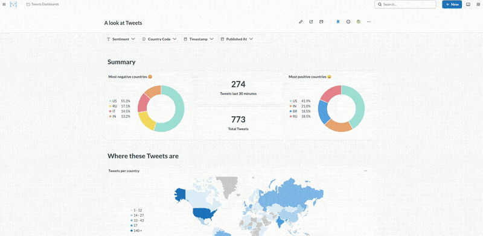

# Real time social analysis
The project aims to perform some sentiment analysis on Twitter data. The dataset used is openly available and the main study area of [Twitter sentiment classification using distant supervision](https://www-cs.stanford.edu/people/alecmgo/papers/TwitterDistantSupervision09.pdf).
The initial idea was to fetch Twitter data in a streaming manner, but because [their platform no longer offers a free tier](https://developer.x.com/) a message producer will be used instead.
Additionally, some simple dashboards can be shown too.
In order to keep the project as open and freely available as possible, free or open data sources are used, along with open source projects. 

# Running the project
The project is aimed to be auto-contained through Docker Compose and some helper scripts.
When all the containers are up-and-running by the Docker Compose process, messages will start flowing in and out of Kafka and into a PySpark process which computes a sentiment value (the possible values being `positive | negative | neutral`) for each message based on the feeling of the text. Then, the result is stored in a PostgreSQL database and along with Metabase some dashboards can be made. The following is an example dashboard:


# AI usage
The use of AI in this particular project is close to none in order to slowly solve the problems or issues that may arise.
It is developed just like we did in the good-old-days, slowly, no rush, relaxed, ... Like a puzzle!
Just because Deep Blue outperformed Kasparov doesn't mean that people stopped playing chess.


# Tech stack
This section briefly explains the technical details of the project.

## Infrastructure
In order to test several services, containerized applications are set up and used altogether to demonstrate their interoperability.


## Development
The project is developed using mainly DDD (Domain Drive Development) in order to ensure maintainability and robustness of the application.

| Scope        | Library     |
| -----------  | ----------- |
| Linter       | Ruff        |
| Typing       | MyPy        |
| Dependencies | uv          |

## Project structure
```
tweet-sentiment-analysis/
├── .github
│   └── GitHub Actions defined for CI/CD
├── docker
│   └── infrastructure services used in the project in a containerized environment
├── README.md
├── pyproject.toml
├── uv.lock
├── .gitignore
├── docs/
│   └── markdown files with documentation regarding the project
├── scripts/
│   └── helper scripts to manage the application
├── src/
│   └── services and code written in Python
└── tests/
    └── test cases
```

## CI/CD
Some GitHub Actions will be defined to check the typing, lint and formatting of the application.
The application is made to be run locally, however, checks on pull requests must be met to ensure we don't break any previous features.

# How to run?
In order to run the project, you must have Docker and Docker Compose installed.
I created some helper scripts to launch the project in Windows (through a batch scripts) and Linux (through bash scripts).
This will create several Docker containers with the different services of the application.
The main idea is that the project is auto-contained and that it can be run anywhere.

To run the project you can run in a terminal:
```batch
.\scripts\run_local.bat  # in Windows systems
./scripts/run_local.sh  # in Linux systems
```

To stop the project and drop all the containers, run in a terminal:
```batch
.\scripts\stop_local.bat  # in Windows systems
./scripts/stop_local.sh  # in Linux systems
```
 