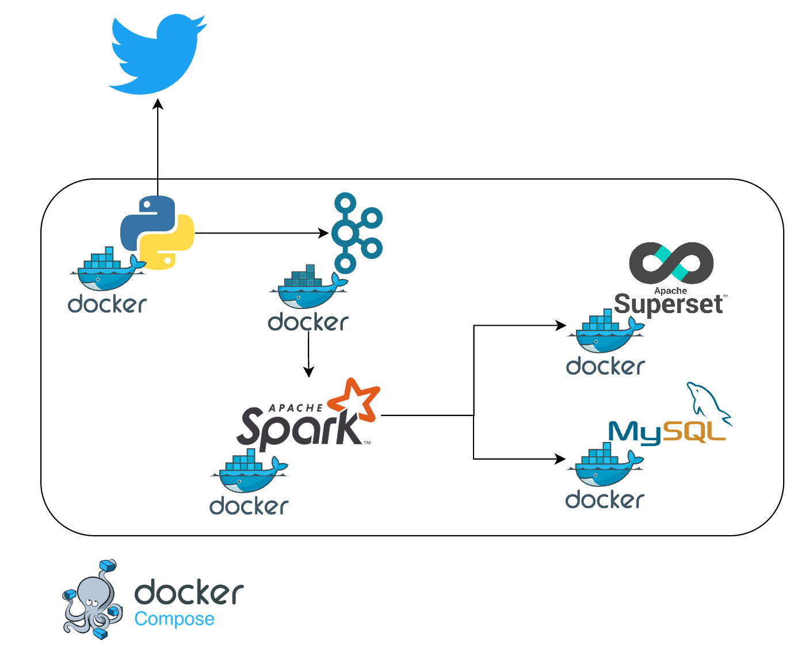

# Real time social analysis
In the context of the coming Spanish presidential elections, this project will gather information on social media on that matter and perform sentiment analysis on it.
Additionally, some simple dashboards can be shown too.
In order to keep the project as open and freely available as possible, free or open data sources are used, along with open source projects. 

# Tech stack
This section briefly explains the technical details of the project.

## Infrastructure
In order to test several services, containerized applications are set up and used altogether to demonstrate their interoperability.


## Development
The project is developed using mainly DDD (Domain Drive Development) in order to ensure maintainability and robustness of the application.

| Scope        | Library     |
| -----------  | ----------- |
| Linter       | Ruff        |
| Typing       | MyPy        |
| Dependencies | Poetry      |

## Project structure
```
tweet-sentiment-analysis/
├── .github
│   └── GitHub Actions defined for CI/CD
├── docker
│   └── infrastructure services used in the project in a containerized environment
├── README.md
├── pyproject.toml
├── uv.lock
├── .gitignore
├── docs/
│   └── markdown files with documentation regarding the project
├── src/
│   └── services and code written in Python
└── tests/
    └── test cases
```

## CI/CD
Some GitHub Actions will be defined to check the typing, lint and formatting of the application.
The application is made to be run locally, however, checks on pull requests must be met to ensure we don't break any previous features.

# How to run?
In order to run the project, you must have the following installed:
 